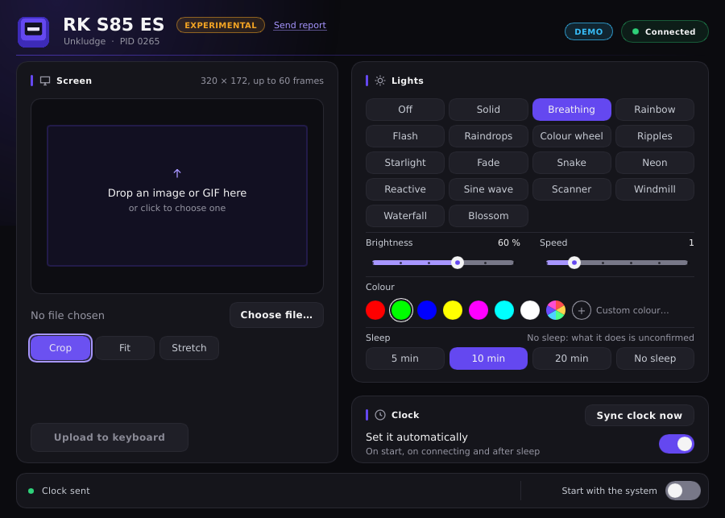

# Unkludge

**App y herramienta de línea de comandos libres y nativas para teclados Royal Kludge (RK) con pantalla, en Windows y Linux, sin el programa de RK.** Pone la imagen o el GIF de la pantalla, la hora y las luces. Está en una fase muy temprana y solo se ha probado en un teclado, en Windows: lee antes el [Estado](#estado).

> Unkludge es un proyecto independiente, no lo hace ni lo respalda Royal Kludge. Ver [Aviso legal](#aviso-legal).

[English](README.md)

## Estado

Las cosas como están hoy.

- **RK S85 ES (`258A:0265`), el teclado del autor:** probado en Windows el 2026-11-05, con la línea de comandos y con la ventana. Leer y escribir los ajustes, un color propio, la hora, la hora automática al abrir, al enchufar y al volver de la suspensión, subir imágenes y GIF, y cancelar. La tabla de modelos aún lo marca como `experimental`.
- **Todos los demás modelos son experimentales y no se han probado nunca.**
- **En Linux la ventana solo se ha visto en modo demo**, dibujada fuera de pantalla o en WSLg, sin ningún teclado real. No se ha probado en ningún Linux de escritorio ni con un teclado real en Linux.
- **No se ha hecho ninguna captura USB**, así que ningún comando está confirmado por esa vía. Los comandos salen del análisis estático del programa de RK.

## Qué hace

Esto es lo que hace el código. El [Estado](#estado) cuenta cuánto ha visto un teclado.

<p align="center">
  
  <br>
  <sub>La ventana de Linux en modo demo, aquí en inglés: no se usa ningún teclado real.</sub>
</p>

- **Reconoce el modelo por su ID USB** y enseña solo los controles que tienen ese modelo y ese efecto.
- **Pantalla:** envía un archivo GIF, PNG, JPEG, BMP o WebP. Recortar, encajar o estirar, con vista previa animada, tiempo estimado, progreso y Cancelar. Arrastra el archivo a la ventana o elígelo.
- **Reloj:** con un botón, o deja que la app lo ponga en hora al arrancar, al conectar y al volver de la suspensión.
- **Luces:** apagadas o uno de 17 efectos, con brillo, velocidad, color (7 huecos de paleta, arcoíris o uno propio) y tiempo de suspensión (5, 10 o 20 minutos, o Sin suspensión). Qué hace Sin suspensión en el teclado está sin confirmar.
- **Se queda en la bandeja** con Abrir, Sincronizar hora, Arrancar con el sistema y Salir.
- **Herramienta de línea de comandos** con las mismas funciones, más un modo de prueba que imprime los paquetes sin abrir ningún teclado.
- En español o inglés, según el idioma del sistema.
- Sin código de red y sin telemetría. No hay instalador.

## Por qué

El programa de RK solo funciona en Windows. Unkludge quiere cubrir toda la familia de teclados RK con pantalla, en Windows y en Linux, con un programa que arranca con la sesión. Habla directamente con el teclado, con los comandos que aparecen en [docs/PROTOCOL.md](docs/PROTOCOL.md).

## Modelos compatibles

Solo por cable USB: un teclado que el sistema dice que está conectado de otra forma se rechaza. Estos son los 29 modelos que Unkludge abre. La lista por ID de producto, generada a partir de la tabla de modelos, está en [docs/MODELS.md](docs/MODELS.md).

| Teclado | ID de producto (fabricante `258A`) | Pantalla | Fotogramas máx. | Estado |
|---|---|---|---|---|
| RK S85 ES | `0265` | 320×172 | 60 | Probado en Windows: luces, hora, subidas y cancelar. Aún marcado como experimental |
| RK S85, ISO Return, RU, TH | `0193`, `01FA`, `0263`, `0264` | 320×172 | 60 | Experimental, sin probar |
| RK S98 y S98RGB, todas las variantes | `0174`, `01AF`, `01BF`, `0223`, `0224`, `022B`, `022F`, `0230`, `023F`, `0240`, `0241` | 320×172 | 60 | Experimental, sin probar |
| RK M87, todas las variantes | `01A2`, `01D6`, `01F5`, `0272`, `0273`, `0274`, `0275`, `0276` | 240×135 | 100 | Experimental, sin probar. La subida añade una suma de comprobación |
| RK S104 | `025A` | 240×135 | 50 | Experimental, sin probar |
| RK N99, TH, RU | `01B8`, `025E`, `025F` | 240×240 | 35 | Experimental, sin probar. Los datos de la pantalla van a una segunda colección HID |
| RK N80 | `0187` | 128×128 | 200 | Experimental, sin probar |

**Experimental** quiere decir que nadie ha confirmado que el modelo funcione con Unkludge. La tabla de modelos marca los 29 como `experimental`, también el S85 ES: un modelo solo pasa a `tested` cuando alguien hace todos los pasos hasta subir algo a la pantalla ([cómo](CONTRIBUTING.md#how-a-model-becomes-tested)).

| Sistema | Estado |
|---|---|
| Windows 11, x64 | Compila y pasa sus tests. Windows 10 no se ha probado |
| Linux, x86-64 | Compila y pasa sus tests en Ubuntu 24.04 sobre WSL2. No se ha probado en ningún Linux de escritorio |

## Instalación

Cada [versión](../../releases) trae los programas para Windows x64 (`.zip`) y Linux x86-64 (`.tar.gz`): la app, `unkludge-app`, y la herramienta de línea de comandos, `unkludge`, con `LICENSE` y `THIRD-PARTY-NOTICES.txt`. El de Linux trae también la [regla udev](#acceso-en-linux) y necesita glibc 2.31 o posterior, como en Ubuntu 20.04 y Debian 11. `SHA256SUMS` tiene sus sumas de comprobación. Los programas no están firmados, así que Windows SmartScreen puede avisar: *Más información* y luego *Ejecutar de todas formas*.

O compílalos desde el código:

### Compilar

Necesita Rust 1.99 o posterior.

```
cargo build --release -p unkludge-app -p unkludge-cli --locked
```

- **Windows** (toolchain MSVC): `target\release\unkludge-app.exe` y `target\release\unkludge.exe`.
- **Linux:** `target/release/unkludge-app` y `target/release/unkludge`. En Debian o Ubuntu necesita:
  `sudo apt install build-essential pkg-config libudev-dev libfontconfig1-dev libxkbcommon-dev`.

Tamaños de la compilación release, medidos con el perfil de `Cargo.toml`:

| Programa | Windows x64 | Linux x86-64 |
|---|---|---|
| `unkludge-app` | 1.071.104 bytes | 11.811.680 bytes |
| `unkludge` | 1.031.680 bytes | 1.344.184 bytes |

Casi todo el tamaño de la app de Linux viene de Slint, su biblioteca de interfaz.

### Windows

1. Copia `unkludge-app.exe` a la carpeta que quieras, y también `unkludge.exe` si quieres la línea de comandos.
2. Cierra el programa de RK si está abierto.
3. Lee [Antes de abrir la app](#antes-de-abrir-la-app) y ejecuta `unkludge-app.exe`.

Haz clic en el icono de la bandeja para abrir la ventana. Al cerrar la ventana, la app sigue en la bandeja. Para salir, clic derecho en el icono y *Salir*.

### Linux

1. Copia `unkludge-app` a la carpeta que quieras, y también `unkludge` si quieres la línea de comandos.
2. Lee [Antes de abrir la app](#antes-de-abrir-la-app) y ejecuta `unkludge-app`.
3. Si no se puede abrir el teclado, la ventana enseña **Dar acceso**. Ver [Acceso en Linux](#acceso-en-linux).

Lo que cambia respecto a Windows:

- **Arrastrar y soltar:** en Wayland no se pueden soltar archivos en la ventana. Allí pone "Haz clic aquí para elegir una imagen o un GIF" en lugar de ofrecerse a recibirlos.
- **Elegir un archivo** usa `zenity` o `kdialog`. Si no hay ninguno, la ventana te pide que escribas la ruta.
- **Bandeja:** el icono usa StatusNotifierItem, así que el escritorio necesita una bandeja que los muestre. GNOME necesita la extensión *AppIndicator*. Sin bandeja, cerrar la ventana la minimiza, Ctrl+Q sale y volver a abrir la app enseña la ventana. Nada de esto se ha probado aún en un Linux de escritorio.

## Antes de abrir la app

- **Escribe en el teclado sin que se lo pidas.** La hora automática viene activada, así que la app envía la hora en cuanto conecta: al arrancar, al enchufar el teclado y al volver de la suspensión. Esto solo se ha comprobado en un S85 ES, en Windows. Se puede apagar en la ventana (*Reloj*, *Ajustarla automáticamente*), pero la primera conexión llega antes. Para tenerla apagada desde el principio, crea el `settings.txt` de la carpeta de datos (ver [Notas](#notas)) como archivo de texto, en UTF-8 o UTF-16, con la línea `auto_clock=0`, antes de abrir la app por primera vez. Un archivo que está ahí tiene que decir `auto_clock=1` para que esté encendida: cualquier otro valor, no tener esa línea y un archivo vacío significan apagada. Un archivo con contenido y sin ningún ajuste que Unkludge conozca cuenta como ilegible: la ventana lo dice, la hora automática se queda apagada y el archivo no se toca. Si el archivo ya existe, el primer arranque tampoco activa lo del siguiente punto.
- **En el primer arranque se activa para iniciarse con el sistema.** Primer arranque es cualquiera en el que no exista `settings.txt`. En Windows es un valor `Unkludge` en `HKCU\Software\Microsoft\Windows\CurrentVersion\Run`. En Linux es `~/.config/autostart/unkludge.desktop`. Los dos arrancan la app con `--tray`. Las compilaciones debug no lo hacen, ni un programa con una carpeta llamada `target` en su ruta, como `target/release`. *Arrancar con el sistema*, en la ventana y en la bandeja, lo apaga.
- **Tu primer color propio sustituye a los demás colores.** El teclado no puede decir qué paletas tiene, y un color propio se escribe junto con las paletas de todos los efectos. Así que el primero en cada modelo devuelve los demás efectos y huecos a los colores de Unkludge: rojo, verde, azul, amarillo, magenta, cian y blanco. Los colores puestos con el programa de RK se sustituyen. La app te avisa antes, una vez por modelo, y a partir de ahí recuerda sus colores. En la línea de comandos pasa con cada `--rgb`, incluso con colores puestos antes con Unkludge, porque no guarda ninguna copia entre ejecuciones. Avisa después de enviar.
- **Cierra el programa de RK.** Sondea el teclado y le vuelve a enviar sus ajustes. Unkludge avisa si hay un programa llamado `DeviceDriver.exe` en marcha, y no hace nada más al respecto. El programa de RK no existe en Linux, así que allí no se comprueba.
- **Mientras está conectada, la app lee los ajustes del teclado cada 5 segundos.** Es una lectura, y además sirve para notar que el teclado se ha ido.
- **Un solo programa de Unkludge a la vez.** La app mantiene un bloqueo sobre el teclado mientras está conectada, así que los comandos de `unkludge` que abren un teclado, también los de lectura, se niegan y te dicen que cierres antes la app. Si un comando ya tiene el teclado cuando la app lo busca, la ventana lo dice y se conecta cuando el comando termina. `--dry-run`, `--demo` y `unkludge models` no abren ningún teclado ni usan el bloqueo. En Windows el bloqueo es un mutex con nombre, uno por sesión de usuario, así que otro usuario con sesión abierta a la vez no queda fuera. En Linux es `flock` sobre el propio nodo hidraw del teclado, así que vale sea cual sea el entorno del programa y para cualquier usuario que pueda abrir el nodo, y dos teclados pueden tener cada uno su programa. El sistema suelta los dos si un programa se cuelga. Solo cuenta para Unkludge: el programa de RK no participa.
- **Una subida sustituye lo que haya en la pantalla, y puede ser lenta.** Un fotograma en una pantalla de 320×172 son 215 paquetes. En un S85 ES eso tardó 38 s, a 5,7 paquetes por segundo, así que un GIF más largo tarda minutos. Cancelar, o cerrar la consola durante una subida, dejó la animación de fábrica del teclado, no lo que había antes.

Para ver la interfaz sin nada de esto, ejecuta `unkludge-app --demo`. Nunca abre un teclado y no toca los ajustes reales ni el autoarranque. `--demo-model 01A2` enseña otro modelo, y `--lang es` o `--lang en` elige el idioma.

## Acceso en Linux

En Linux, un programa necesita permiso para abrir el dispositivo hidraw del teclado. Si no lo tiene, la ventana enseña **Dar acceso**. Ese botón usa `pkexec`, así que te pide la contraseña una vez, escribe `/etc/udev/rules.d/70-unkludge.rules` y le dice a udev que la aplique. Si la regla ya está y el teclado sigue sin abrirse, la ventana te pide que lo desenchufes y lo vuelvas a enchufar. Si no hay `pkexec`, o para la línea de comandos, que no tiene ese botón, instala la regla a mano desde esta carpeta de código:

```
sudo install -m 0644 packaging/linux/70-unkludge.rules /etc/udev/rules.d/
sudo udevadm control --reload-rules && sudo udevadm trigger --subsystem-match=hidraw --action=change
```

**Hasta dónde llega la regla.** Tiene una línea por cada uno de los 29 modelos compatibles, como esta:

```
KERNEL=="hidraw*", ATTRS{idVendor}=="258a", ATTRS{idProduct}=="0265", TAG+="uaccess"
```

Cubre todos los nodos hidraw de esos modelos, y no solo la colección que usa Unkludge. Eso incluye las interfaces por las que pasan las pulsaciones de teclas. No elige interfaces porque en qué interfaz están las colecciones que necesita Unkludge solo se sabe en el S85 ES, y la segunda colección de la familia N99 no se conoce en absoluto. Los demás dispositivos con el ID de fabricante `258A` se quedan fuera. Con la regla instalada, cualquier programa que se ejecute con el usuario que esté delante del ordenador puede abrir esos nodos, no solo Unkludge. Unkludge abre solo el nodo que necesita e ignora lo que llegue por él que no sea una confirmación. En Linux un nodo es la interfaz entera, así que lo que lo mantiene alejado del resto de esa interfaz es la lista de comandos que envía.

Para quitar la regla, borra ese archivo y ejecuta la segunda orden de arriba.

## Línea de comandos

```
unkludge [--pid <HEX>] [--dry-run] [--timing] [--verbose] <COMANDO>
```

| Comando | Qué hace | El teclado |
|---|---|---|
| `unkludge models` | Lista los modelos compatibles. `--markdown` imprime [docs/MODELS.md](docs/MODELS.md) | No se abre |
| `unkludge info` | El modelo, lo que ofrece, sus ajustes y su bloque de configuración | Lee |
| `unkludge light` | Sin opciones, enseña los ajustes de las luces | Lee |
| `unkludge light <opciones>` | Los cambia | **Escribe** |
| `unkludge clock` | Pone el reloj en la hora local. El teclado no responde, así que míralo en su pantalla | **Escribe** |
| `unkludge screen <ARCHIVO>` | Envía un archivo GIF, PNG, JPEG, BMP o WebP | **Escribe** |
| `unkludge report` | Imprime los datos que hacen falta para avisar de un problema | Lee |

Un comando que abre un teclado se niega mientras la app esté conectada a él, así que cierra antes la app: ver [Un solo programa de Unkludge a la vez](#antes-de-abrir-la-app).

Opciones de `light`:

| Opción | Valores |
|---|---|
| `--mode <N\|off>` | Un número de efecto, de 1 a 17, u `off` |
| `--brightness <BYTE>` | Uno de los valores que lista `info`: 0, 4, 8, 12, 16 o 20 en los 29 modelos |
| `--speed <N>` | De 0 a 5 en los 29 modelos |
| `--color <HUECO\|rainbow>` | Un hueco de paleta de 0 a 6, o `rainbow` |
| `--rgb <RRGGBB>` | Un color propio. Lo que hace con los demás está en [Antes de abrir la app](#antes-de-abrir-la-app) |
| `--sleep <TIEMPO>` | `5`, `10`, `20` o `never`. Qué hace `never` en el teclado está sin confirmar |

Opciones de `screen`:

| Opción | Valores |
|---|---|
| `--fit <FIT>` | `cover` (la predeterminada) recorta, `contain` añade bandas negras, `stretch` cambia la forma de la imagen |
| `--delay <MS>` | Milisegundos por fotograma, en lugar de lo que diga el archivo |
| `--truncate` | Se queda con los fotogramas que caben en el límite del modelo. Sin esto, un archivo con demasiados fotogramas da error |

Con más de 6 fotogramas y un tiempo por fotograma menor que el tiempo de dibujo del modelo (180 ms en el S85 ES), solo se envía parte de los fotogramas. La salida dice cuántos. Ctrl+C durante `screen` le pide al teclado que aborte, lo que puede tardar unos segundos si se ha quedado parado. Un segundo Ctrl+C sale al momento y deja la subida a medias. En Linux, cerrar el terminal, SIGTERM y SIGHUP hacen lo mismo que Ctrl+C, en `unkludge` y en la app. Si llegan más se ignoran, y el programa termina solo 30 segundos después si no lo ha hecho antes. Una señal que ya venía ignorada al arrancar, como SIGHUP con `nohup`, sigue ignorada. En Windows, cerrar la consola hace lo mismo en `unkludge`, y cerrar la sesión o apagar lo hace en la app. Los dos tienen unos 5 segundos. Un teclado parado puede tardar más, hasta 16 segundos, y entonces la subida se queda a medias. Windows termina `unkludge` sin más al cerrar la sesión o apagar, así que entonces el teclado no recibe la orden de abortar.

`unkludge` termina con 0 si todo ha ido bien y con 1 si hay un error. Si el teclado recibió todos los fotogramas de una subida pero no confirmó el final, imprime un aviso y termina con 2: puede que el teclado muestre la animación nueva o puede que no.

Opciones de todos los comandos:

| Opción | Qué hace |
|---|---|
| `--pid <HEX>` | El teclado, por su ID de producto USB, como `0265`. Sin ella, el primero compatible que encuentre. Obligatoria con `--dry-run` |
| `--dry-run` | Imprime los paquetes en vez de abrir un teclado. No se envía nada |
| `--timing` | Imprime cuánto se tardó en enviar y en esperar, con los paquetes por segundo |
| `--verbose` | Imprime cada paquete entero con `--dry-run`, y cada confirmación con `--timing` |

Para ver qué enviaría un comando, sin teclado:

```
unkludge --dry-run --pid 0265 clock
unkludge --dry-run --pid 0265 light --mode 2 --brightness 12 --speed 3 --color 0 --sleep 10
unkludge --dry-run --pid 0265 light --mode 2 --rgb FF1080
unkludge --dry-run --pid 0265 screen imagen.gif --fit contain --delay 200 --truncate
```

En un `--dry-run` no hay teclado del que leer, así que lee como si las luces estuvieran apagadas: para cambiar un brillo, una velocidad o un color hace falta también `--mode`.

## Seguridad

**Lo que Unkludge nunca envía.** No tiene ningún comando para esto, ni forma de enviar bytes arbitrarios:

- Actualizaciones de firmware ni entrar en un bootloader. Esto no se añadirá nunca.
- Un restablecimiento de fábrica.
- Mapas de teclas, macros, colores por tecla ni efectos en tiempo real, en esta versión.
- Ningún byte de comando que no sea `0x84`, `0x04`, `0x0A`, `0x0B`, `0x0C`, `0x0D` o `0x82`, ni ningún ID de report que no sea `0x09`. Un test ejecuta todos los flujos y falla si sale cualquier otra cosa. La lista exacta está en [docs/PROTOCOL.md](docs/PROTOCOL.md#never-sent).

**Cómo escribe.** Los ajustes se leen primero y se vuelven a escribir solo con lo que has pedido cambiar. Los bytes que no conoce conservan su valor. Si la lectura falla o el bloque no termina en `5A A5`, no se escribe nada: ni ajustes, ni el reloj, ni una subida a la pantalla, desde la app o desde la línea de comandos.

**Lo que no se sabe.** Esto no es ninguna promesa de que nada pueda salir mal. Ninguna captura USB ha confirmado los comandos, y Unkludge solo ha escrito en un teclado real. En él, una subida cortada sin abortar dejó en la pantalla un aviso de carga hasta la siguiente subida. No se sabe qué pasa al desenchufar uno a mitad. [docs/PROTOCOL.md](docs/PROTOCOL.md#not-confirmed) lista lo que está sin confirmar. Si un teclado deja de responder, desenchúfalo y vuelve a enchufarlo.

## Probar un modelo y contar qué pasa

El orden para probar, de menos a más riesgo, está en [CONTRIBUTING.md](CONTRIBUTING.md#testing-a-model): `info`, `light`, `report`, `clock`, `light` con opciones, `screen`. Para en lo primero que tenga mala pinta.

Para contar qué ha pasado, [abre un issue](../../issues) con la salida de `unkludge report`. Imprime los datos: la versión de Unkludge, el sistema, si el programa de RK está en marcha, los ID USB y las colecciones HID de cualquier dispositivo de este fabricante que liste el sistema, el modelo y el bloque de configuración en hexadecimal. Sin nombres, cuentas ni archivos.

La app tiene un enlace **Enviar informe** en los modelos experimentales y en los no compatibles, y en un teclado compatible que encuentra pero no puede usar, sea por lo que sea. Todavía no hay ningún formulario, así que por ahora el enlace solo guarda `unkludge-report.txt` en la carpeta de datos, abre esa carpeta y te dice que envíes el archivo.

## Notas

- Los ajustes y registros (`settings.txt`, `unkludge.log`, `crash.log`, `unkludge-report.txt`) están en `%APPDATA%\Unkludge` en Windows y en `~/.config/unkludge` en Linux, o en `$XDG_CONFIG_HOME/unkludge` si está definido. Un registro que llega a 256 KB pasa a ser `unkludge.log.old` o `crash.log.old`, en lugar del anterior.
- En un S85 ES, para volver de la imagen a la página con la fecha, la batería, la hora y Mayús: pulsa la rueda y, en selección de interfaz, elige la interfaz de tiempo. Es el menú del propio teclado, y Unkludge no tiene ningún comando para eso.
- `unkludge-app --tray` arranca escondida en la bandeja. Si la app ya está en marcha, volver a abrirla enseña su ventana.
- En Linux, el socket con el que se pide esa ventana está en `$XDG_RUNTIME_DIR` si está definido y es tuyo, y si no, en la carpeta de datos.
- Para quitar Unkludge: apaga *Arrancar con el sistema*, sal de la app y borra los programas y la carpeta de datos y, en Linux, la [regla udev](#acceso-en-linux).

## Licencia

[GPL-3.0](LICENSE). Unkludge no tiene ninguna garantía, como dice la licencia.

## Aviso legal

Aquí se cuenta qué es el proyecto y de dónde salen sus partes. No es asesoramiento legal, y no dice si algo de esto está permitido donde vives.

- **Proyecto independiente.** Unkludge no está afiliado, autorizado, respaldado ni patrocinado por Royal Kludge. No es software oficial de RK y su soporte técnico no puede ayudarte con él: mejor [abre un issue](../../issues) aquí.
- **Nombres.** "Royal Kludge", "RK" y los nombres de los modelos son de sus dueños. Se usan para indicar para qué teclados está pensado Unkludge.
- **De dónde salen los comandos.** Se sacaron con un análisis estático del programa de RK para Windows, es decir, leyendo el código del programa y sus archivos de configuración, con el fin de que los teclados que la gente ya tiene funcionen sin él. No se usó ninguna captura USB. [docs/PROTOCOL.md](docs/PROTOCOL.md) describe el comportamiento con palabras propias. Las notas de ese análisis se quedan fuera de este repositorio, y aquí no hay código descompilado.
- **Lo que sale de los archivos de RK.** Los 218 archivos de `data/models/` se generan a partir de los `KB.ini` que instala el programa de RK, con `tools/kbini2toml`, y están escritos en el formato propio de Unkludge. Guardan los ID USB, los nombres de los modelos, los tamaños de pantalla, los límites de fotogramas, qué controles tiene cada efecto y las posiciones de las teclas. Los programas llevan compilado todo menos las posiciones de las teclas. Estos datos se tomaron de los archivos de RK, no se dedujeron por otra vía.
- **Lo que no.** No se incluye ninguna imagen, animación, programa ni firmware del programa de RK. Los nombres de los efectos son de Unkludge. Las etiquetas de los cuatro tiempos de suspensión coinciden con las del programa de RK.
- **Bajo tu responsabilidad.** Esto solo ha funcionado en un teclado real ([Estado](#estado)). Lo usas bajo tu responsabilidad.
- **Titulares de derechos.** Si este proyecto te plantea alguna duda, contacta con quien lo mantiene a través de [GitHub](https://github.com/esdedev) y se atenderá cuanto antes.
