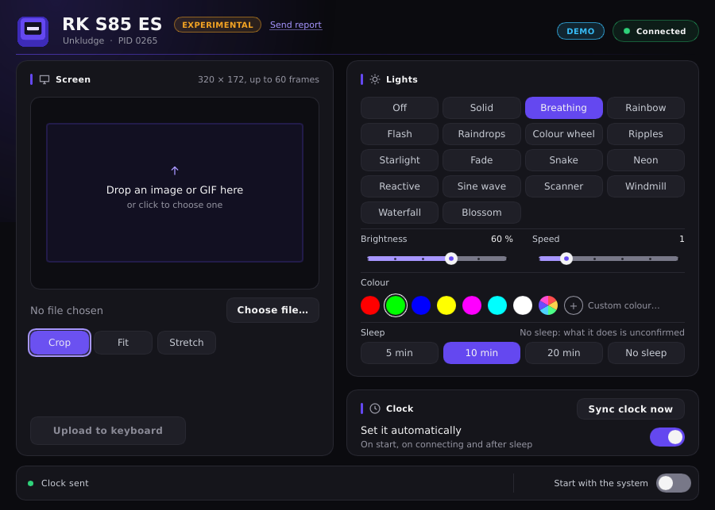

# Unkludge

**A free, native app and command-line tool for Royal Kludge (RK) keyboards with a screen, on Windows and Linux, without RK's software.** It sets the screen's image or GIF, the clock and the lights. It's at an early stage and almost entirely untested on real keyboards: read [Status](#status) first.

> Unkludge is an independent project, not made or endorsed by Royal Kludge. See [Legal note](#legal-note).

[Español](README.es.md)

## Status

This is how things really stand. Nothing has been released yet.

- **RK S85 ES (`258A:0265`), the author's keyboard:** Unkludge has only read from it, with `unkludge --pid 0265 info` and `unkludge --pid 0265 light` with no options.
- **No Unkludge write has been run on real hardware.** Not the lights, not the clock, not a screen upload. Those have only run against a simulated keyboard, in the tests.
- **Every other model is experimental and has never been run.**
- **The window has only been seen in demo mode**, offscreen or in WSLg, with no real keyboard.
- **No USB capture has been made**, so no command has been confirmed that way. The commands come from static analysis of RK's software.

## What it does

This is what the code does. [Status](#status) says how little of it has met a keyboard.

<p align="center">
  
  <br>
  <sub>The Linux window in demo mode: no real keyboard is used.</sub>
</p>

- **Knows the model by its USB ID** and shows only the controls that model and effect have.
- **Screen:** sends a GIF, PNG, JPEG, BMP or WebP file. Crop, fit or stretch, with an animated preview, a time estimate, progress and Cancel. Drop a file on the window or choose one.
- **Clock:** set it with a button, or let the app set it on start, on connecting and after sleep.
- **Lights:** off or one of 17 effects, with brightness, speed, colour (7 palette slots, rainbow or your own) and sleep time (5, 10 or 20 minutes, or No sleep). What No sleep does on the keyboard is unconfirmed.
- **Stays in the tray** with Open, Sync clock, Start with the system and Quit.
- **Command-line tool** with the same functions, plus a dry run that prints the reports without opening a keyboard.
- English or Spanish, following the system language.
- No network code and no telemetry. There's no installer.

## Why

RK's software only runs on Windows. Unkludge is meant to cover the whole family of RK keyboards with a screen, on Windows and on Linux, with a program that starts with your session. It talks to the keyboard directly, with the commands listed in [docs/PROTOCOL.md](docs/PROTOCOL.md).

## Supported models

Wired USB only. These are the 29 models Unkludge opens. The list by product ID, generated from the model table, is in [docs/MODELS.md](docs/MODELS.md).

| Keyboard | Product IDs (vendor `258A`) | Screen | Max frames | Status |
|---|---|---|---|---|
| RK S85 ES | `0265` | 320×172 | 60 | Read-only commands run, nothing written |
| RK S85, ISO Return, RU, TH | `0193`, `01FA`, `0263`, `0264` | 320×172 | 60 | Experimental, never run |
| RK S98 and S98RGB, all variants | `0174`, `01AF`, `01BF`, `0223`, `0224`, `022B`, `022F`, `0230`, `023F`, `0240`, `0241` | 320×172 | 60 | Experimental, never run |
| RK M87, all variants | `01A2`, `01D6`, `01F5`, `0272`, `0273`, `0274`, `0275`, `0276` | 240×135 | 100 | Experimental, never run. Upload adds a checksum |
| RK S104 | `025A` | 240×135 | 50 | Experimental, never run |
| RK N99, TH, RU | `01B8`, `025E`, `025F` | 240×240 | 35 | Experimental, never run. Screen data goes to a second HID collection |
| RK N80 | `0187` | 128×128 | 200 | Experimental, never run |

**Experimental** means nobody has confirmed the model works with Unkludge. The model table marks all 29 as `experimental`, the S85 ES too: a model becomes `tested` only after someone runs every step up to a screen upload ([how](CONTRIBUTING.md#how-a-model-becomes-tested)).

| System | Status |
|---|---|
| Windows 11, x64 | Builds and passes its tests. Windows 10 hasn't been tried |
| Linux, x86-64 | Builds and passes its tests on Ubuntu 24.04 under WSL2. No desktop Linux has been tried |

## Install

There are no releases, packages or download links yet, and no public repository. Installing means building from source.

### Build

Needs Rust 1.99 or later.

```
cargo build --release -p unkludge-app -p unkludge-cli --locked
```

- **Windows** (MSVC toolchain): `target\release\unkludge-app.exe` and `target\release\unkludge.exe`.
- **Linux:** `target/release/unkludge-app` and `target/release/unkludge`. On Debian or Ubuntu it needs:
  `sudo apt install build-essential pkg-config libudev-dev libfontconfig1-dev libxkbcommon-dev`.

Release sizes, as measured with the profile in `Cargo.toml`:

| Program | Windows x64 | Linux x86-64 |
|---|---|---|
| `unkludge-app` | 1,046,016 bytes | 11,790,944 bytes |
| `unkludge` | 994,816 bytes | 1,319,608 bytes |

Most of the Linux app's size comes from Slint, its interface toolkit.

### Windows

1. Copy `unkludge-app.exe` to a folder of your choice, and `unkludge.exe` too if you want the command line.
2. Close RK's app if it's running.
3. Read [Before you open the app](#before-you-open-the-app), then run `unkludge-app.exe`.

Click the tray icon to open the window. Closing the window keeps the app running in the tray. To quit, right-click the icon and choose *Quit*.

### Linux

1. Copy `unkludge-app` to a folder of your choice, and `unkludge` too if you want the command line.
2. Read [Before you open the app](#before-you-open-the-app), then run `unkludge-app`.
3. If the keyboard can't be opened, the window shows **Grant access**. See [Linux access](#linux-access).

Some differences from Windows:

- **Drag and drop:** the window can't take dropped files on Wayland. There it shows "Click here to choose an image or GIF" instead of offering to take one.
- **Choosing a file** uses `zenity` or `kdialog`. With neither, the window asks you to type the file's path.
- **Tray:** the icon uses StatusNotifierItem, so the desktop needs a tray that shows those. GNOME needs the *AppIndicator* extension. With no tray, closing the window minimizes it, Ctrl+Q quits, and running the app again shows the window. None of this has been tried on a desktop Linux yet.

## Before you open the app

- **It writes to the keyboard without being asked.** Automatic clock is on by default, so the app sends the time as soon as it connects: on start, on plugging the keyboard in and after sleep. Unkludge has never run this command on real hardware. You can turn it off in the window (*Clock*, *Set it automatically*), but the first connection comes before you can. To have it off from the start, create the data folder's `settings.txt` (see [Notes](#notes)) as a text file, in UTF-8 or UTF-16, with the line `auto_clock=0`, before the first launch. Any value but `1` means off. A file that's there and has no setting Unkludge knows counts as unreadable: the window says so, the automatic clock stays off and the file stays as it is. A file that's already there also keeps the first launch from turning on the next item.
- **It turns on starting with the system at first launch**, which is any launch with no `settings.txt`. On Windows that's a `Unkludge` value under `HKCU\Software\Microsoft\Windows\CurrentVersion\Run`. On Linux it's `~/.config/autostart/unkludge.desktop`. Both start the app with `--tray`. Debug builds don't do this, and neither does a program with a folder called `target` in its path, as in `target/release`. *Start with the system*, in the window and in the tray, turns it off.
- **Your first custom colour replaces the other colours.** The keyboard can't report its palettes, and a custom colour is written together with the palettes of every effect. So the first one on a model puts the other effects, and the other slots, back to Unkludge's defaults: red, green, blue, yellow, magenta, cyan and white. Colours set in RK's app are replaced. The app warns you first, once per model, and remembers its colours from then on. On the command line every `--rgb` does this, even to colours set earlier with Unkludge, as it keeps no copy between runs. It prints a warning after sending.
- **Close RK's app.** It polls the keyboard and sends its own settings back. Unkludge warns if a program named `DeviceDriver.exe` is running, and that warning is all it does about it. RK's app doesn't exist on Linux, so there's no such check there.
- **While connected, the app reads the keyboard's settings every 5 seconds.** That's a read, and it also notices the keyboard going away.
- **One Unkludge program at a time.** The app keeps a lock on the keyboard for as long as it's connected, so `unkludge` commands that open a keyboard, reads included, refuse and tell you to quit the app first. If a command already has the keyboard when the app looks for it, the window says so and connects when the command ends. `--dry-run`, `--demo` and `unkludge models` open no keyboard and take no lock. It's a named mutex on Windows and `flock` on a file on Linux, and the system lets go of both if a program crashes. It only knows about Unkludge: RK's app doesn't take part. It's per user session, so another user logged in at the same time isn't kept out.
- **A screen upload replaces what's on the screen, and it may be slow.** A frame on a 320×172 screen is 215 chunks. Unkludge's speed hasn't been measured.

To look at the interface with none of this, run `unkludge-app --demo`. It never opens a keyboard and leaves the real settings and autostart alone. `--demo-model 01A2` shows another model and `--lang es` or `--lang en` picks a language.

## Linux access

On Linux, a program needs permission to open the keyboard's hidraw device. When it can't, the window shows **Grant access**. That button uses `pkexec`, so it asks for your password once, writes `/etc/udev/rules.d/70-unkludge.rules` and tells udev to apply it. If the rule is there and the keyboard still can't be opened, the window asks you to unplug it and plug it back in. If there's no `pkexec`, or for the command line, which has no such button, install the rule by hand from this source tree:

```
sudo install -m 0644 packaging/linux/70-unkludge.rules /etc/udev/rules.d/
sudo udevadm control --reload-rules && sudo udevadm trigger --subsystem-match=hidraw --action=change
```

**What the rule reaches.** The rule has one line for each of the 29 supported models, such as:

```
KERNEL=="hidraw*", ATTRS{idVendor}=="258a", ATTRS{idProduct}=="0265", TAG+="uaccess"
```

It covers every hidraw node of those models, not only the collection Unkludge uses. That includes the interfaces that carry key presses. It doesn't pick interfaces because which interface holds the collections Unkludge needs is only known on the S85 ES, and the second collection of the N99 family isn't known at all. Other devices with vendor ID `258A` are left out. While the rule is installed, any program running as the user at the computer can open those nodes, not just Unkludge. Unkludge opens only the node it needs and ignores any input there that isn't an ack. On Linux a node is the whole interface, so the list of commands it sends is what keeps it away from the rest of that interface.

To remove the rule, delete that file and run the second command above.

## Command line

```
unkludge [--pid <HEX>] [--dry-run] [--timing] [--verbose] <COMMAND>
```

| Command | What it does | The keyboard |
|---|---|---|
| `unkludge models` | Lists the supported models. `--markdown` prints [docs/MODELS.md](docs/MODELS.md) | Isn't opened |
| `unkludge info` | The model, what it offers, its settings and its config block | Reads |
| `unkludge light` | With no options, shows the lighting settings | Reads |
| `unkludge light <options>` | Changes them | **Writes** |
| `unkludge clock` | Sets the clock to the local time. The keyboard doesn't answer, so look at its screen | **Writes** |
| `unkludge screen <FILE>` | Sends a GIF, PNG, JPEG, BMP or WebP file | **Writes** |
| `unkludge report` | Prints the details a bug report needs | Reads |

`light` options:

| Option | Values |
|---|---|
| `--mode <N\|off>` | An effect number, 1 to 17, or `off` |
| `--brightness <BYTE>` | One of the bytes `info` lists: 0, 4, 8, 12, 16 or 20 on all 29 models |
| `--speed <N>` | 0 to 5 on all 29 models |
| `--color <SLOT\|rainbow>` | A palette slot from 0 to 6, or `rainbow` |
| `--rgb <RRGGBB>` | A colour of your own. See [Before you open the app](#before-you-open-the-app) for what it does to the others |
| `--sleep <TIME>` | `5`, `10`, `20` or `never`. What `never` does on the keyboard is unconfirmed |

`screen` options:

| Option | Values |
|---|---|
| `--fit <FIT>` | `cover` (the default) crops, `contain` adds black bars, `stretch` changes the image's shape |
| `--delay <MS>` | Milliseconds per frame, instead of what the file says |
| `--truncate` | Keeps the frames that fit the model's limit. Without it, a file with too many frames is an error |

With more than 6 frames and a delay shorter than the model's draw time (180 ms on the S85 ES), only some of the frames get sent. The output says how many. Ctrl+C during `screen` asks the keyboard to abort, which can take a few seconds if it has stalled. A second Ctrl+C quits at once and leaves the upload unfinished.

Options for every command:

| Option | What it does |
|---|---|
| `--pid <HEX>` | The keyboard, by USB product ID, such as `0265`. Without it, the first supported keyboard found. Required with `--dry-run` |
| `--dry-run` | Prints the reports instead of opening a keyboard. Nothing is sent |
| `--timing` | Prints how long sending and waiting took, with chunks per second |
| `--verbose` | Prints every report in full with `--dry-run`, and every ack with `--timing` |

To see what a command would send, without a keyboard:

```
unkludge --dry-run --pid 0265 clock
unkludge --dry-run --pid 0265 light --mode 2 --brightness 12 --speed 3 --color 0 --sleep 10
unkludge --dry-run --pid 0265 light --mode 2 --rgb FF1080
unkludge --dry-run --pid 0265 screen picture.gif --fit contain --delay 200 --truncate
```

A dry run has no keyboard to read from, so it reads as if the lights were off: changing a brightness, speed or colour there also needs `--mode`.

## Safety

**What Unkludge never sends.** It has no command for any of these, and no way to send arbitrary bytes:

- Firmware updates, or entering a bootloader. This will never be added.
- A factory reset.
- Key maps, macros, per-key colours or live effects, in this version.
- Any command byte other than `0x84`, `0x04`, `0x0A`, `0x0B`, `0x0C`, `0x0D` and `0x82`, or any report ID other than `0x09`. A test runs every flow and fails if anything else goes out. [docs/PROTOCOL.md](docs/PROTOCOL.md#never-sent) has the exact list.

**How it writes.** Settings are read first and written back with only what you asked to change. Bytes it doesn't know keep their value. If the read fails or the block doesn't end in `5A A5`, nothing is written.

**What isn't known.** This is no promise that nothing can go wrong. The commands have not been confirmed by a USB capture, and Unkludge has never written to a real keyboard. Nobody knows yet what a keyboard does if an upload just stops, as when it's unplugged. [docs/PROTOCOL.md](docs/PROTOCOL.md#not-confirmed) lists what's unconfirmed. If a keyboard stops responding, unplug it and plug it back in.

## Testing a model and reporting

The order to test in, from least to most risky, is in [CONTRIBUTING.md](CONTRIBUTING.md#testing-a-model): `info`, `light`, `report`, `clock`, `light` with options, `screen`. Stop at the first thing that looks wrong.

There's no public repository yet, so **there's nowhere to send a report for now**. `unkludge report` prints the details: Unkludge's version, the system, whether RK's app is running, the USB IDs and HID collections of any device of this vendor the system lists, the model, and the config block in hex. No names, accounts or files.

The app has a **Send report** link on experimental and unsupported models. There's no form to send it to yet, so for now the link only saves `unkludge-report.txt` in the data folder, opens that folder and tells you to send the file.

## Notes

- Settings and logs (`settings.txt`, `unkludge.log`, `crash.log`, `unkludge-report.txt`) live in `%APPDATA%\Unkludge` on Windows and `~/.config/unkludge` on Linux, or `$XDG_CONFIG_HOME/unkludge` if that's set.
- `unkludge-app --tray` starts hidden in the tray. Running the app when it's already running shows its window.
- To remove Unkludge: turn off *Start with the system*, quit, then delete the programs and the data folder, and on Linux the [udev rule](#linux-access).

## License

[GPL-3.0](LICENSE). Unkludge comes with no warranty, as the license says.

## Legal note

This says what the project is and where its parts come from. It isn't legal advice, and it doesn't say whether any of this is allowed where you are.

- **Independent project.** Unkludge is not affiliated with, authorized, endorsed or sponsored by Royal Kludge. It isn't official RK software, and RK's support can't help with it.
- **Names.** "Royal Kludge", "RK" and the model names belong to their owners. They're used to say which keyboards Unkludge is meant for.
- **Where the commands come from.** They were worked out by static analysis of RK's Windows app, which means reading the program's code and config files, with the aim of making keyboards people own work without it. No USB capture was involved. [docs/PROTOCOL.md](docs/PROTOCOL.md) describes the behaviour in our own words. The notes from that analysis stay outside this repository, and no decompiled code is in it.
- **What comes from RK's files.** The 218 files in `data/models/` are generated from the `KB.ini` files that RK's app installs, by `tools/kbini2toml`, and written in Unkludge's own format. They hold USB IDs, model names, screen sizes, frame limits, which controls each effect has and key positions. The programs compile in everything but the key positions. This data was taken from RK's files, not worked out independently.
- **What doesn't.** No images, animations, programs or firmware from RK's app are included. Effect names are Unkludge's own. The labels for the four sleep times match the ones in RK's app.
- **Your risk.** Most of this has never run on a real keyboard ([Status](#status)). You use it at your own risk.
- **Rights holders.** There's no public repository or contact address yet. One will be listed here when there is.
